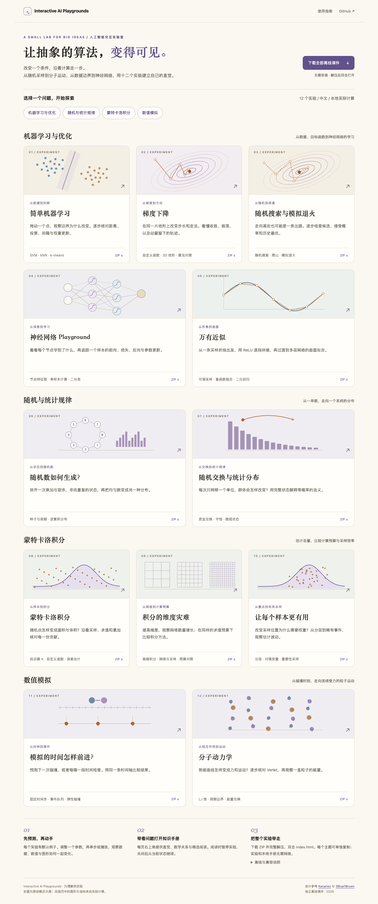

# Interactive AI Playgrounds

**让抽象的算法，变得可见。** 十二个中文交互实验，面向没有人工智能背景的理工科学生。改变条件，逐步核对计算，再用证据解释结果。

[打开实验室](https://ftp.dtsci.cn/IntroductionToAI/) · [下载全部离线课件](https://ftp.dtsci.cn/IntroductionToAI/dist/ai-interactive-courseware.zip) · [验证记录](./TESTING.md) · [设计参考](./DESIGN_RESEARCH.md)



## 十二个可以带走的实验

| 实验 | 可以亲手验证什么 | 离线包与说明 |
| --- | --- | --- |
| [简单机器学习](https://ftp.dtsci.cn/IntroductionToAI/topics/machine-learning-algorithms/) | 移动训练点；逐步核对 SVM 得分、损失、次梯度，kNN 距离与投票，k-means 分配与均值。 | [ZIP](./dist/machine-learning-algorithms.zip) · [教学说明](./topics/machine-learning-algorithms/README.md) |
| [梯度下降](https://ftp.dtsci.cn/IntroductionToAI/topics/gradient-descent/) | 自定义双变量函数，比较 GD、动量、RMSProp、Adam；在同一地形上检查梯度、记忆与位移。 | [ZIP](./dist/gradient-descent.zip) · [教学说明](./topics/gradient-descent/README.md) |
| [随机搜索与模拟退火](https://ftp.dtsci.cn/IntroductionToAI/topics/monte-carlo-optimization/) | 自定义目标；从随机数到候选、接受概率与历史最优，比较随机搜索、爬山和模拟退火。 | [ZIP](./dist/monte-carlo-optimization.zip) · [教学说明](./topics/monte-carlo-optimization/README.md) |
| [神经网络 Playground](https://ftp.dtsci.cn/IntroductionToAI/topics/mlp-playground/) | 四种二分类数据；查看节点特征图，逐层检查单次前向、交叉熵、反向梯度与参数更新。 | [ZIP](./dist/mlp-playground.zip) · [教学说明](./topics/mlp-playground/README.md) |
| [万有近似](https://ftp.dtsci.cn/IntroductionToAI/topics/universal-approximation/) | 自定义一元与二元函数、采样点数；从折线和单隐藏层 ReLU 构造，过渡到多层网络真实回归。 | [ZIP](./dist/universal-approximation.zip) · [教学说明](./topics/universal-approximation/README.md) |
| [随机数如何生成](https://ftp.dtsci.cn/IntroductionToAI/topics/random-number-generation/) | 拆开LCG状态更新；检查周期与相邻关系；把均匀数映射到指数或离散分布。 | [ZIP](./dist/random-number-generation.zip) · [教学说明](./topics/random-number-generation/README.md) |
| [随机交换与统计分布](https://ftp.dtsci.cn/IntroductionToAI/topics/random-processes/) | 同一候选序列对比负债约束；枚举28个微观状态，区分状态等概率与余额分布。 | [ZIP](./dist/random-processes.zip) · [教学说明](./topics/random-processes/README.md) |
| [蒙特卡洛积分](https://ftp.dtsci.cn/IntroductionToAI/topics/monte-carlo-integration/) | 从π到双变量曲面；自定义函数和区域，逐点核对贡献与积分误差。 | [ZIP](./dist/monte-carlo-integration.zip) · [教学说明](./topics/monte-carlo-integration/README.md) |
| [积分的维度灾难](https://ftp.dtsci.cn/IntroductionToAI/topics/curse-of-dimensionality/) | 调整1–12维，在相同求值预算下比较完整张量网格与随机采样。 | [ZIP](./dist/curse-of-dimensionality.zip) · [教学说明](./topics/curse-of-dimensionality/README.md) |
| [让每个样本更有用](https://ftp.dtsci.cn/IntroductionToAI/topics/variance-reduction/) | 分层、对偶变量、重要性采样与普通抽样对照；查看稀有事件权重。 | [ZIP](./dist/variance-reduction.zip) · [教学说明](./topics/variance-reduction/README.md) |
| [模拟的时间怎样前进](https://ftp.dtsci.cn/IntroductionToAI/topics/event-driven-simulation/) | 同一硬球初态对比固定步与事件驱动，检查接触方程、冲量和失效预报。 | [ZIP](./dist/event-driven-simulation.zip) · [教学说明](./topics/event-driven-simulation/README.md) |
| [分子动力学](https://ftp.dtsci.cn/IntroductionToAI/topics/molecular-dynamics/) | 从LJ势与力到Verlet单步；周期盒、能量交换、外界冷却和时间步对照。 | [ZIP](./dist/molecular-dynamics.zip) · [教学说明](./topics/molecular-dynamics/README.md) |

七个随机与模拟主题参考用户原有SCML Jupyter课件重新设计，保留资金交换、π、稀有事件与LJ/Verlet等案例；每页保留科学边界、本地解释与来源。原“蒙特卡洛优化”保留路径，显示名改为“随机搜索与模拟退火”，与积分教学分开。

每个实验都有单步、播放与暂停、可复现条件和重新开始入口。图形、指标和运算读取同一份实际计算状态；不会用预置曲线冒充训练。

## 知识就在实验旁边

每页右上角的 **知识手册** 包含三个层次：

- **直觉与实验**：解释图上各部分的意义，给出控制变量的操作问题与常见误解。
- **数学关系**：用本地 KaTeX 排版关键公式，联系页面中的真实中间量。
- **延伸阅读**：指向 3Blue1Brown、Distill、官方算法文档和原始论文，标明阅读范围。

打开手册会暂停正在运行的实验，保留参数与进度；关闭后由学习者手动继续。支持键盘标签切换、焦点循环与 Esc 关闭。外部阅读需主动联网打开，本地解释和核心实验不需要网络。

## 离线使用

1. 下载总包或某个主题 ZIP，**完整解压**。
2. 双击根部 `index.html` 选择实验；单主题则直接打开该目录的 `index.html`。
3. 分享某个实验时复制整个主题目录，包括 `vendor/`。

不需要安装 Node.js、Python、插件或字体，不需要账号、API Key、服务器或 GPU。每个主题可以移出仓库独立运行；资源全部使用目录内相对路径。运行时没有 CDN、在线 API、远程图片、远程字体或嵌入网页。

新增主题已在 macOS 上以 Chrome 155.0.8059.82 和 Firefox 153.0 进行断网 `file://` 验收；既有主题历史验证版本和本次发布检查范围见验证记录；Windows、Linux、Safari、原生浏览器菜单 200% 缩放和屏幕阅读器实机尚未验证。详细日期、操作范围和未测项见 [TESTING.md](./TESTING.md)。

## 教学与设计

默认路径是“先预测 → 改变一个条件 → 观察计算 → 解释差异 → 再验证”。常用控件在实验附近，长公式、更多参数和教师说明按需展开。

本轮视觉与交互参考 [Kanaries Playground](https://ml.kanaries.net/playground) 和 [3Blue1Brown](https://www.3blue1brown.com/)：暖纸背景、清楚的标题层级、较安静的图形与连续的数学叙事。页面、封面 SVG 和中文知识说明由本项目编写，未复制参考网站的代码、图片、视频或字体。研究与采用范围见 [DESIGN_RESEARCH.md](./DESIGN_RESEARCH.md)。

这些实验有明确边界：数据是合成示例；有限次优化不保证全局最优；训练误差下降不代表泛化改善；万有近似讨论表达能力，不保证一次训练成功。各主题在页面和说明中保留失败例子与算法简化条件。

## 目录与维护

```text
index.html                  实验目录，可直接打开
topics/<topic>/            十二个可独立运行的完整主题
dist/                      十二个主题 ZIP、总包与 SHA-256
development/studio/        知识手册与公共导航的开发源文件
development/vendor/        本地可视化库的固定版本构建配置
tests/                     数值、状态、离线、浏览器与发布检查
docs/images/               本项目实际页面截图
```

开发与验收规范在 [AGENTS.md](./AGENTS.md)。本仓库按知识主题组织，不绑定某一学期、课程或厂商。后续 LLM 选题单列于 [候选路线](./LLM_VISUALIZATION_ROADMAP.md)，尚未实现的内容不列为已交付。

以下工具仅供开发维护，学生无需执行：

```sh
# 重新生成目录与每个主题的本地知识手册
python3 development/build_index.py
python3 development/studio/build_knowledge.py
python3 development/build_stochastic_guides.py
python3 development/build_sampling.py

# 数值与静态资源审计
python3 tests/offline-audit.py
node tests/expression.cjs
node tests/machine-learning-algorithms.cjs
node tests/optimization.cjs
node tests/mlp-playground.cjs
node tests/universal-approximation.cjs
node tests/stochastic-models.cjs

# 将验收后的主题打包为独立离线成品
python3 development/package_courseware.py
```

浏览器测试使用 Playwright（本轮1.62.1，历史版本见验证记录；仅开发环境），运行 `tests/browser-*.cjs`。可通过 `COURSE_TOPICS_ROOT` 指定待验收解压目录，通过 `COURSE_QA_OUTPUT` 指定截图输出目录。Chrome 可用 `COURSE_CHROME_PATH` 指定已安装的浏览器，Firefox 使用 Playwright 对应运行文件。测试脚本中的开发环境不属于课件的运行条件。

## 第三方资源

D3 7.9.0 与 KaTeX 0.19.0 已保存到各主题 `vendor/`，包括所需字体、许可证和校验值。各主题 `THIRD_PARTY.md` 记录具体来源、版本、修改与设计借鉴。外部阅读原文没有重新打包分发，保留原作者署名与权利。
